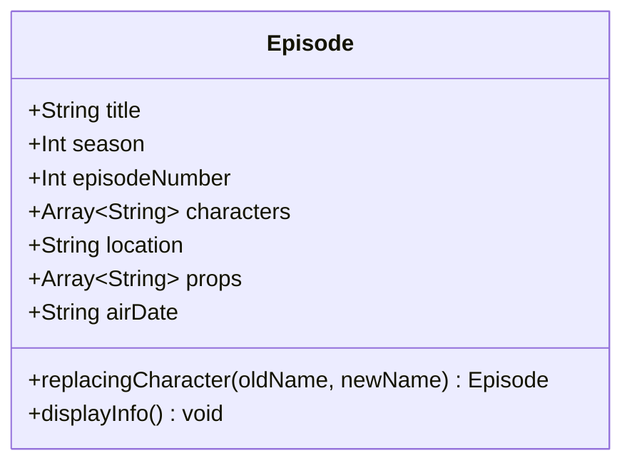

# Swift Collections & Value Modeling

[](https://swift.org)
[](https://apple.com)
[](LICENSE)

A clean domain modeling architecture showcasing Swift's value semantics (`struct`), collection algorithms, higher-order functions, string transformations, and immutable data flow design patterns.

---

## 🚀 Key Competencies & Skills Demonstrated

- **Value Types & Immutability (`struct`)**: Designing immutable models that preserve thread safety and predictable state flow through non-mutating transformation methods.
- **Collection Manipulation & Sorting Algorithms**: Leveraging Swift's `Comparable` protocol for ascending lexicographical sorting (`sorted()`) and closure-based descending comparisons (`sorted(by: >)`).
- **Subsequences & Slices (`Substring`)**: Utilizing `.prefix(_:)` for memory-efficient substring extraction and slicing without unnecessary allocations.
- **Functional State Transformations**: Implementing pure instance transforms (`replacingCharacter(...)`) that return fresh modified copies while keeping original references completely intact.
- **Defensive State Verification**: Unit-style assertion logic confirming immutability and successful data replacement.

---

## 📂 Repository Structure

```tree
swift-collections-and-struct-modeling/
├── Sources/
│   └── main.swift                # Standalone Swift executable script
├── EpisodeModeling.playground/   # Interactive Xcode Playground environment
│   ├── Contents.swift
│   └── contents.xcplayground
├── .gitignore                    # Swift & Xcode environment exclusions
├── LICENSE                       # MIT Open Source License
└── README.md                     # Project documentation
```

---

## 🔍 Architecture & Domain Model



### Immutable Value Transformation
```swift
struct Episode {
    let title: String
    let season: Int
    let episodeNumber: Int
    let characters: [String]
    let location: String
    let props: [String]
    let airDate: String
    
    // Pure function: Returns a new copy, keeping the original instance immutable
    func replacingCharacter(oldName: String, with newName: String) -> Episode {
        var updatedCharacters = characters
        if let index = updatedCharacters.firstIndex(of: oldName) {
            updatedCharacters[index] = newName
        }
        return Episode(
            title: title,
            season: season,
            episodeNumber: episodeNumber,
            characters: updatedCharacters,
            location: location,
            props: props,
            airDate: airDate
        )
    }
}
```

---

## 💻 Sample Output

```text
==========================================================
 Swift Collections & Struct Modeling: Domain Architecture
==========================================================

--- 1. Collection Sorting Algorithms ---
Original Count: 19 characters

🔤 Alphabetical Order (A-Z) [First 5]:
Adam, Aleksander Tiedemann, Bartosz Tiedemann, Charlotte Doppler, Claudia Tiedemann...

🔤 Reverse Alphabetical Order (Z-A) [First 5]:
Ulrich Nielsen, Regina Tiedemann, Peter Doppler, Noah, Mikkel Nielsen...

--- 2. Substring & Prefix Operations ---
  "Jonas Kahnwald" -> 4-char prefix: 'Jona'
  "Martha Nielsen" -> 4-char prefix: 'Mart'
  "Ulrich Nielsen" -> 4-char prefix: 'Ulri'

--- 3. Immutable Struct Modeling & Transformation ---

[Original State]
📺 Episode: "Secrets" (Season 1, Episode 1)
📍 Location: Winden, Germany
📅 Air Date: December 1, 2017
👥 Characters (11):
   • Jonas Kahnwald
   ...

[Transformed State (Pure Replacement)]
📺 Episode: "Secrets" (Season 1, Episode 1)
👥 Characters (11):
   • Adam
   ...

================== VERIFICATION ==================
✅ Success: Immutability verified. Original struct untouched; new struct updated.
==================================================
```

---

## 🛠️ How to Run

### Option 1: Swift Command Line
```bash
swift Sources/main.swift
```

### Option 2: Xcode Playground
1. Open `EpisodeModeling.playground` in Xcode.
2. Run interactively to inspect live output in the Xcode Console / Canvas.

---

## 📄 License

This project is licensed under the [MIT License](LICENSE).
